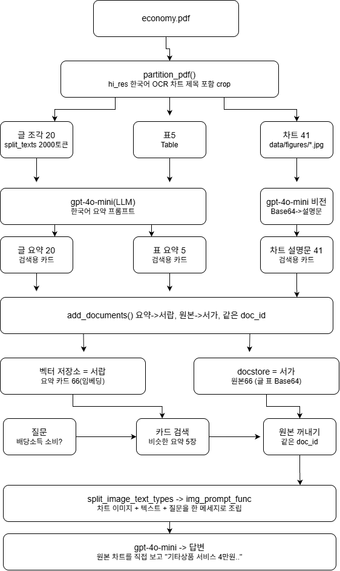

# 멀티모달 RAG — 한국은행 「경제상황 평가(2026년 10월)」

PDF의 **텍스트·표·차트 이미지**를 함께 검색하고 답하는 멀티모달 RAG입니다.
요약으로 검색하고, 답변은 원본(차트 이미지·원문)을 보고 만듭니다.

## 1. 문제 정의

**이 PDF를 고른 이유**
- 한국은행 「경제상황 평가(2026년 10월)」 (21쪽, 공개 보도자료)
- 팀에서 테스트 해볼 때 결과값이 제일 명확했음

**텍스트만으로 부족한 점**
- 본문은 "증가할 전망" 등과 같은 결론만 언급함
- 차트에 진짜 숫자가 있음
- 텍스트만 읽었을때는 "몇 만원?", "몇 만명?"처럼 숫자를 묻는 질문에 답할수 없음

| 예시 | 본문에 있는 정보 | 차트에만 있는 정보 |
| --- | --- | --- |
| 배당소득의 소비효과 | "재량적 지출을 중심으로 나타날 것" | 품목별 금액 (오락·문화 3.6만원 등, 그림 13) |
| 고용 | "제조업 감소폭 축소, 서비스업 증가폭 확대" | 산업별 취업자수 증감 (만명, 4쪽 차트) |
| 이전지출 | "20조원 내외 증액" | 항목별 구성 (그림 17) |


## 2. 아키텍처



> draw.io로 직접 작도. 위에서부터 ① 파싱 → ② 요약 → ③ 저장·검색·답변 순서이며, 오른쪽 열(차트 41 → 비전 → 차트 설명문)이 텍스트 RAG 대비 추가된 이미지 경로입니다.

### 왜 "요약으로 검색, 원본으로 답변"인가 (내 말로)

**왜 차트를 요약문으로 바꿨나**
- 검색은 질문 글과 저장된 글이 얼마나 비슷한지 비교하는 방식
- 차트는 그림이라서 텍스트와 비교 불가
- VLM이 차트를 보고 글로 설명해줘야 검색대상이 됨

**왜 답할 때는 원본 차트를 주나**
- 요약은 세부 숫자가 빠지거나 틀릴 수 있음
- 답변의 정확도를 위해 모델이 차트를 직접보고 숫자를 읽게 해야함
- 찾는 건 요약, 답하는 건 원본으로 이뤄져야 한다

**doc_id**
- 요약 카드와 원본에 붙이는 택

## 3. 기술 선택 근거

| 항목 | 선택 | 이유 |
| --- | --- | --- |
| 파싱 전략 | `hi_res` + `languages=["kor","eng"]` | `fast`는 레이아웃 모델을 안 써서 차트·표 블록을 못 나눕니다. 한국어 문서라 OCR 언어를 지정했습니다. |
| 이미지 crop | 세로 여백 110px (`EXTRACT_IMAGE_BLOCK_CROP_VERTICAL_PAD`) | 이 보고서는 차트 제목이 그림 위 텍스트라 기본 crop에서 빠집니다. 제목이 있어야 VLM 요약과 답변 모델이 어떤 차트인지 구분합니다 (4-4 참고). |
| 이미지 필터 | 짧은 변 150px 미만 삭제 | 아이콘 제거용. 이번 문서에서는 걸린 이미지가 0개였습니다 (한계 2번). |
| 청크 | `by_title`, 2000토큰 / overlap 200 | 보고서가 "□ 요약문 → ▪ 세부" 구조라 제목 단위로 묶어야 문맥이 유지됩니다. overlap은 경계에서 문장이 잘리는 것을 막습니다. |
| 요약 모델 | `gpt-4o-mini` | 텍스트·이미지 모두 처리 가능(VLM)하고, 차트 40여 장을 요약해도 비용이 낮습니다. 교안의 `gpt-4-vision-preview`는 지원 종료입니다. |
| 프롬프트 언어 | 한국어 요약 | 질문이 한국어이므로 요약도 한국어로 만들어야 질문-요약 임베딩 유사도가 높습니다. 이미지 프롬프트는 지시는 영어, 출력은 한국어로 해 지시 이행을 안정화했습니다. |
| 이미지 요약 프롬프트 | 제목·단위·계열명·기간·핵심 수치 포함 지시 | 차트 검색은 결국 "무슨 차트인가"를 맞히는 문제라, 제목과 축 정보가 요약에 꼭 들어가야 합니다. |
| 임베딩 | `text-embedding-3-small` | 한국어 성능이 ada-002보다 좋고 저렴합니다. |
| 벡터 저장소 | `InMemoryVectorStore` (Chroma 선택 가능) | 이 환경에서 Chroma 인메모리 검색이 간헐적으로 빈 결과를 반환했습니다 (4-4 참고). 문서 66개라 전수 비교로 충분합니다. |
| 검색 k | 5 | k=4에서는 텍스트 블록이 상위를 차지해 차트가 밀려났습니다. 이미지 1장이 수백 KB라 더 키우면 답변 입력이 과도해집니다. |
| 답변 이미지 해상도 | `detail: "high"` | 막대 위 작은 숫자 라벨을 읽기 위함. |
| 번역 체인 | Ollama `llama3.1:8b` 우선, 없으면 `gpt-4o-mini` | 교안 7-5. 이 PC에는 Ollama 모델이 설치돼 있지 않아 실행 결과는 `gpt-4o-mini` 번역입니다. |

## 4. 결과

### 4-1. 추출 결과

| 요소 | 개수 | 비고 |
| --- | --- | --- |
| 텍스트 블록 (`CompositeElement`) | 12 → 토큰 분할 후 20 | `by_title` 청킹 |
| 표 (`Table`) | 5 | 부록 「국내외 주요 경제지표」 표 4개 + 1쪽 문의처 표 1개(오탐) |
| 이미지 | 41 | `data/figures/figure-{쪽}-{번호}.jpg` (로고 2개 포함) |
| 색인(요약) 수 | 멀티모달 66 / 텍스트 전용 25 | 20 + 5 + 41 |

### 4-2. 질의응답 5건 (멀티모달 RAG)

정답은 PDF 원문·차트를 직접 보고 확인했습니다. 근거 종류는 검색된 상위 5개 요약의 종류입니다.

| # | 질문 | 멀티모달 RAG 답변 (요약) | 근거가 된 원본 | 정답 여부 |
| --- | --- | --- | --- | --- |
| 1 | 배당소득이 100만원 늘 때 소비반응이 가장 큰 품목 3가지와 금액은? | 기타상품·서비스 4.0만원, 오락·문화 3.6만원, 교통·운송 3.1만원 ([그림 13]) | image, text | ✅ 정답 |
| 2 | 2027년 가계 이전지출 구성에서 증가 규모가 가장 큰 항목과 금액은? | 연금·퇴직수급자 6.8조원 ([그림 17]) | image, text | △ 지원대상별 기준으로는 정답. 지원성격별까지 보면 최대는 사회보험·연금급여 7.6조원 |
| 3 | 2026년 3/4분기 산업별 취업자수 증감에서 서비스업·제조업은? | 서비스업 +22만명, 제조업 −6만명 | image, table, text | ❌ 오답 (정답 +29만명 / −3만명). 차트는 맞게 검색됐으나 인접 막대 값을 읽음 |
| 4 | 소비자물가·근원물가의 3/4분기 상승률과 금년·내년 전망은? | 둘 다 2.9%. 금년 2.7%·2.5% 부합, 내년 기존 전망 2.3%·2.5% 상회 | image, table, text | ✅ 정답 |
| 5 | 2027년 성과급 규모와 업종별 차이는? | 약 60~70조원, 삼성전자·SK하이닉스 약 60조원으로 반도체 집중 ([그림 9]) | image, text | ✅ 정답 (업종별 차트 수치까지는 제시 안 함) |

**결과: 정답 3건, 부분 정답 1건, 오답 1건**

### 4-3. Before / After — 텍스트 RAG vs 멀티모달 RAG

같은 요약 파이프라인, 같은 프롬프트, 같은 k=5로 저장소 내용만 다르게 했습니다.
(텍스트 RAG = 텍스트+표만, 멀티모달 RAG = 텍스트+표+이미지)

| # | 텍스트 RAG (Before) | 멀티모달 RAG (After) |
| --- | --- | --- |
| 1 | ❌ "화장품 및 위생용품 5만원, 미용서비스 4만원, 보험서비스 3만원" → **환각**. 각주에 나온 품목명에 숫자를 지어냄 | ✅ 4.0 / 3.6 / 3.1만원, [그림 13] 근거 명시 |
| 2 | ❌ "연금·퇴직수급자, 약 20조원" → 20조원은 **이전지출 총액**이지 항목 금액이 아님 | △ 6.8조원 (항목 금액을 차트에서 읽음) |
| 3 | "자료에서 확인할 수 없습니다" (정직한 거절) | ❌ 차트를 찾았지만 값을 잘못 읽음 |
| 4 | ✅ 본문에 있는 수치라 동일하게 정답 | ✅ |
| 5 | ✅ 본문에 있는 수치라 동일하게 정답 | ✅ |

<details>
<summary>Q1 원문 출력 캡처 (노트북 셀 출력 그대로)</summary>

```
Q1. 배당소득이 100만원 늘어날 때 소비반응이 가장 큰 품목 3가지와 각각의 금액은?

[텍스트 RAG] (근거: text)
1. **화장품 및 위생용품**: 5만원
2. **미용서비스**: 4만원
3. **보험서비스**: 3만원
이 정보는 [그림 13]에서 읽은 수치입니다.

[멀티모달 RAG] (근거: image, text)
1. 기타상품·서비스: 4.0만원
2. 오락·문화: 3.6만원
3. 교통·운송: 3.1만원
이 데이터는 [그림 13] "배당소득에 대한 품목별 소비반응"에서 읽은 수치입니다.
```
</details>

**Q1 텍스트 RAG 답변을 보고**
- 차트 숫자가 없는데도 모른다고 하지 않음
- 각주에 있던 품목에 숫자를 지어냄 → 환각 발생

**Q3은 멀티모달인데도 틀린 이유**
- 검색은 성공했으나 답변단계에서 틀림. 모델이 막대가 많은 차트에서 옆 막대 숫자를 잘못 읽었음
- 작은 모델이라서 그럴 수 있을 가능성

### 4-4. 어려웠던 점

- 차트 제목이 잘려서 비슷한 차트 두 개를 구분하지 못함. crop 여백을 늘려 해결
- Chroma 검색이 빈 결과를 줌. 저장소를 바꿔서 해결
- hi_res 파싱이 3분넘게 걸림

자세한 기록:

| 문제 | 원인 | 해결 |
| --- | --- | --- |
| 배당소득 질문에 **일시소득 차트(그림 11)** 수치로 답함 | 기본 crop은 차트 영역만 잘라 "[그림 13] 배당소득에 대한…" **제목이 이미지에 없음**. 비슷한 막대그래프 두 장을 구분할 근거가 없음 | `EXTRACT_IMAGE_BLOCK_CROP_VERTICAL_PAD=110`으로 제목·출처까지 포함해 crop → 이미지 요약에 "[그림 N] 제목"이 들어가고 Q1 정답 |
| 이전지출·취업자수 질문에서 **차트가 아예 검색 안 됨** | 제목 없는 요약("서비스 분야별 소비 지출" 등)이라 질문과 유사도가 낮고, 텍스트 블록이 k=4를 다 차지 | 위 제목 포함 + k=4→5 |
| 노트북 실행 시 `similarity_search`가 **간헐적으로 빈 결과** (3회 중 2회) | Chroma(1.x, 인메모리)를 hi_res 레이아웃 모델이 올라간 커널에서 쓸 때만 발생. 같은 데이터로 단독 스크립트 3회는 모두 정상 | 문서 66개 규모라 `InMemoryVectorStore`(전수 코사인 비교)로 교체. `create_multi_vector_retriever(backend="chroma")`로 교안 구성도 그대로 사용 가능 |

## 5. 실행 방법

사전 설치(OS 프로그램): **Poppler**, **Tesseract**(한국어 `kor` 데이터 포함). 둘 다 Path 등록 후 터미널·에디터 재시작.

```bash
git clone https://github.com/yewon-studio/multimodal_rag.git
cd multimodal_rag

python -m venv .venv
.venv\Scripts\activate              # macOS/Linux: source .venv/bin/activate

pip install --upgrade pip
pip install -r requirements.txt     # 또는 requirements.lock.txt

python -m ipykernel install --user --name multimodal-rag

copy .env.example .env              # macOS/Linux: cp .env.example .env
# .env 에 OPENAI_API_KEY 입력
```

1. 한국은행 홈페이지(bok.or.kr)에서 「경제상황 평가(2026년 10월)」 PDF를 받아 `data/economy.pdf`로 저장합니다. (PDF는 `.gitignore` 대상)
2. `notebooks/Multi_modal_RAG.ipynb`를 `Python (multimodal-rag)` 커널로 열고 위에서부터 실행합니다.

## 6. 프로젝트 구조

```
multimodal-rag/
├── .env.example            # 필요한 환경변수 안내 (실제 키 없음)
├── .gitignore
├── requirements.txt
├── requirements.lock.txt
├── README.md
├── docs/
│   └── architecture.png    # 아키텍처 다이어그램 (draw.io 직접 작도)
├── data/
│   ├── economy.pdf         # 원본 PDF (Git 제외)
│   ├── figures/            # 추출된 차트 이미지 (Git 제외)
│   └── processed/          # 파싱·요약 캐시 *.pkl (Git 제외, 재실행 시 API 비용 절약)
├── notebooks/
│   └── Multi_modal_RAG.ipynb
└── src/
    ├── extract.py          # ① PDF 파싱
    ├── summarize.py        # ② 텍스트·표·이미지 요약
    └── retriever.py        # ③ 다중 벡터 검색기 + 최종 체인 + 번역 체인
```

## 7. 한계와 개선 방향

다음에 해보고 싶은 것
- 원본 차트와 요약문 같이 넣어보기
- 차트가 아닌 이미지 걸러내기
- 질문 수를 5개보다 늘려서 비교군 늘리기

## 8. 보안

- `.env`는 `.gitignore`에 포함되어 커밋되지 않으며, 저장소에는 키가 없는 `.env.example`만 있습니다.
- 커밋 전 `git grep -E "sk-[A-Za-z0-9_-]{20,}"`로 키 문자열이 없는지 확인했습니다.
- 원본 PDF와 추출 이미지는 용량 문제로 커밋하지 않습니다.
